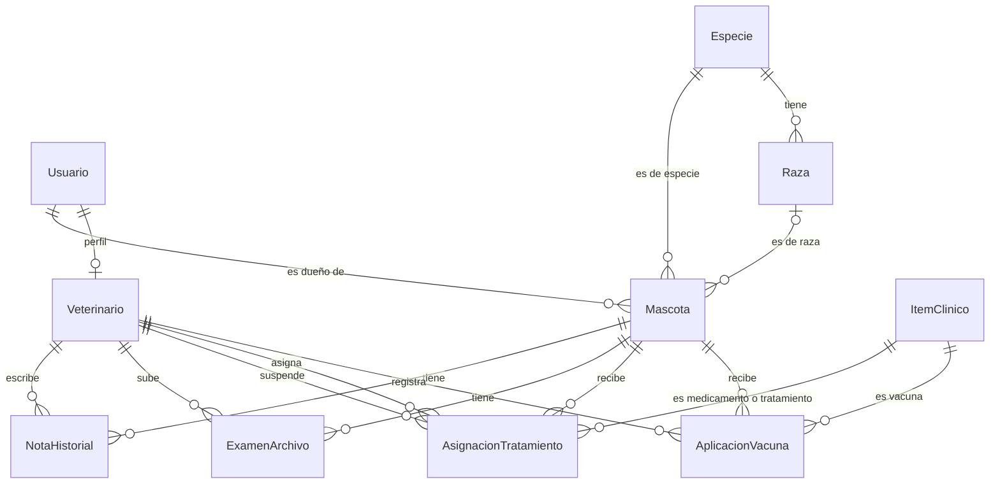

# Propuesta de modelo de base de datos — Expediente Electrónico Veterinario

Estado: **propuesta pendiente de aprobación** (Fase 1 del plan de trabajo).

Base de datos: SQL Server (somee). Esquema compartido por el módulo web MVC (integrantes 1 y 2) y la API REST para Flutter (integrante 3).

## Decisiones que hay que aprobar

1. **Dueños como usuarios.** El dueño inicia sesión en la app móvil, así que es un `Usuario` con `Rol = Dueno`. No hay tabla aparte.
2. **Roles como texto (enum).** Valores: `Administrador`, `Veterinario`, `Dueno`. Sin tabla `Roles`, para simplificar la autenticación por cookies y JWT.
3. **Vacunas dentro del catálogo clínico.** `ItemClinico` tiene `Tipo` = `Medicamento`, `Tratamiento` o `Vacuna`.
4. **Archivos (fotos y exámenes) guardados en la BD como `varbinary(max)`.** Render usa disco efímero: los archivos guardados en disco se pierden en cada redeploy. Alternativa: almacenamiento externo (Azure Blob, S3, Cloudinary). Se recomienda la BD por simplicidad, pero conviene validar el límite de tamaño de la BD de somee.
5. **Integridad del catálogo con `DeleteBehavior.Restrict`.** Nunca `Cascade` sobre catálogos ni sobre entidades clínicas. Esto evita el borrado en cascada silencioso que tiene TiendaMVC.
6. **Autoría (trazabilidad).** Cada registro clínico guarda `VeterinarioId` (quien lo creó). Se muestra en la vista y en la API.

## Entidades

### Seguridad y personas

**Usuario**
| Campo | Tipo | Notas |
|---|---|---|
| Id | int PK | |
| Cedula | nvarchar(20) | Única |
| Nombre | nvarchar(100) | |
| Apellidos | nvarchar(150) | |
| Email | nvarchar(256) | Única |
| PasswordHash | nvarchar(max) | Hash seguro (PBKDF2 o Identity PasswordHasher) |
| Rol | nvarchar(20) | `Administrador`, `Veterinario`, `Dueno` |
| Bloqueado | bit | Usuarios bloqueados no pueden iniciar sesión ni usar la API |
| FechaCreacion | datetime2 | |

**Veterinario** (perfil de un Usuario con rol `Veterinario`)
| Campo | Tipo | Notas |
|---|---|---|
| Id | int PK | |
| UsuarioId | int FK → Usuario | 1:1, única |
| NumeroColegiado | nvarchar(50) | Única |
| Foto | varbinary(max) | Ver decisión 4 |
| FotoContentType | nvarchar(100) | |

### Catálogos

**Especie**
| Campo | Tipo | Notas |
|---|---|---|
| Id | int PK | |
| Nombre | nvarchar(80) | Única |

**Raza**
| Campo | Tipo | Notas |
|---|---|---|
| Id | int PK | |
| EspecieId | int FK → Especie | `Restrict` |
| Nombre | nvarchar(80) | Única por especie (EspecieId, Nombre) |

**ItemClinico** (medicamentos, tratamientos y vacunas)
| Campo | Tipo | Notas |
|---|---|---|
| Id | int PK | |
| Nombre | nvarchar(120) | Única por tipo (Tipo, Nombre) |
| Tipo | nvarchar(20) | `Medicamento`, `Tratamiento`, `Vacuna` |
| Descripcion | nvarchar(500) | Opcional |
| Activo | bit | Permite suspender del catálogo sin borrar |

### Pacientes

**Mascota**
| Campo | Tipo | Notas |
|---|---|---|
| Id | int PK | |
| Nombre | nvarchar(100) | |
| EspecieId | int FK → Especie | `Restrict` |
| RazaId | int FK → Raza | `Restrict`, opcional |
| DuenoId | int FK → Usuario | Usuario con rol `Dueno`, `Restrict` |
| FechaNacimiento | date | Opcional |
| Sexo | nvarchar(10) | Opcional |
| Foto | varbinary(max) | Ver decisión 4 |
| FotoContentType | nvarchar(100) | |

La "última atención" no es una columna: se calcula como el máximo de `NotaHistorial.FechaRegistro` de la mascota.

### Expediente clínico

**AplicacionVacuna**
| Campo | Tipo | Notas |
|---|---|---|
| Id | int PK | |
| MascotaId | int FK → Mascota | `Restrict` |
| ItemClinicoId | int FK → ItemClinico | Tipo `Vacuna`, `Restrict` |
| VeterinarioId | int FK → Veterinario | **Autoría** |
| FechaAplicacion | date | |
| ProximaDosis | date | Opcional; base de la alerta de vencidas en Flutter |

**AsignacionTratamiento** (medicamentos y tratamientos vigentes o suspendidos)
| Campo | Tipo | Notas |
|---|---|---|
| Id | int PK | |
| MascotaId | int FK → Mascota | `Restrict` |
| ItemClinicoId | int FK → ItemClinico | Tipo `Medicamento` o `Tratamiento`, `Restrict` |
| VeterinarioId | int FK → Veterinario | **Autoría** de la asignación |
| FechaInicio | date | |
| Indicaciones | nvarchar(500) | |
| Suspendido | bit | Vigente = no suspendido |
| FechaSuspension | date | Opcional |
| VeterinarioSuspensionId | int FK → Veterinario | **Autoría** de la suspensión, opcional |

**ExamenArchivo**
| Campo | Tipo | Notas |
|---|---|---|
| Id | int PK | |
| MascotaId | int FK → Mascota | `Restrict` |
| VeterinarioId | int FK → Veterinario | **Autoría** |
| Descripcion | nvarchar(300) | |
| Contenido | varbinary(max) | PDF o imagen |
| ContentType | nvarchar(100) | `application/pdf`, `image/png`, etc. |
| NombreArchivo | nvarchar(260) | |
| FechaSubida | datetime2 | |

**NotaHistorial** (inmutable: sin edición ni borrado)
| Campo | Tipo | Notas |
|---|---|---|
| Id | int PK | |
| MascotaId | int FK → Mascota | `Restrict` |
| VeterinarioId | int FK → Veterinario | **Autoría** |
| Contenido | nvarchar(max) | HTML del texto enriquecido, sanitizado |
| FechaRegistro | datetime2 | Orden cronológico |

Inmutabilidad: el controlador no expone editar ni borrar. Opcionalmente se puede reforzar con un trigger o con un permiso de BD denegando `UPDATE`/`DELETE` sobre la tabla.

## Diagrama

## Reglas de integridad (requisito del enunciado)

| Acción | Resultado |
|---|---|
| Borrar una especie con razas o mascotas | Bloqueado (`Restrict`) y mensaje en la app |
| Borrar una raza con mascotas | Bloqueado |
| Borrar un ítem del catálogo clínico con aplicaciones o asignaciones | Bloqueado; el administrador debe marcarlo `Activo = 0` |
| Borrar una mascota con expediente | Bloqueado |
| Editar o borrar una `NotaHistorial` | No disponible en la app |

## Siguientes pasos tras la aprobación

1. Crear las entidades en C# y `AppDbContext` con estas reglas.
2. Generar la migración inicial (sin aplicarla a somee todavía).
3. Revisar la migración con el equipo y luego aplicarla a somee, con tu confirmación explícita.
4. Datos semilla: roles no aplican (son enum), pero sí especies y un administrador inicial.
